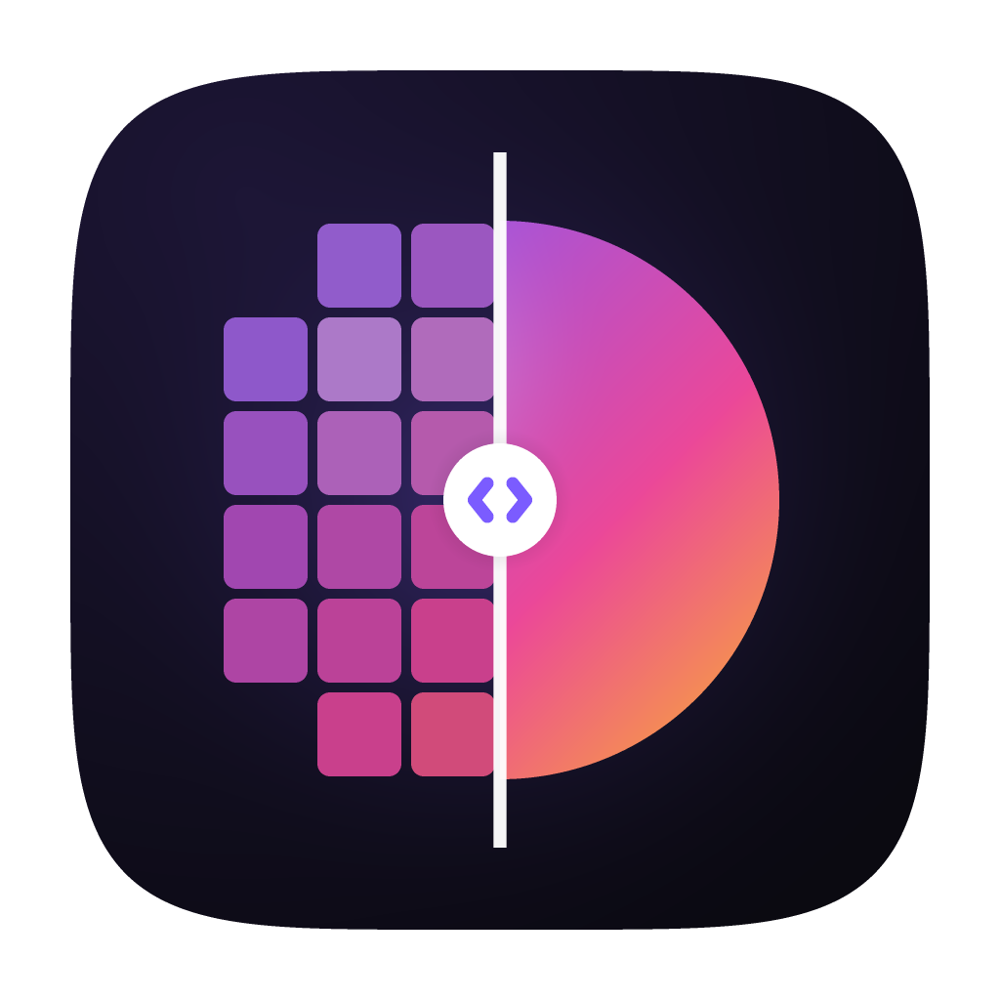

<p align="center"></p>

<h1 align="center">TouchUp</h1>

<p align="center">Upscale images, video and audio with open-source AI engines that run on your own computer.</p>

TouchUp is a desktop app built with [giode](https://github.com/mehran9675/giode). It doesn't
upscale anything itself: it installs and drives command-line engines such as Real-ESRGAN or
AudioSR, and takes care of everything around them. That means extracting and re-encoding video
frames, keeping the original soundtrack, converting audio, running jobs in a queue and showing
before/after comparisons. Nothing is uploaded.

## Features

- **Any engine.** A built-in catalog of open-source engines installs with one click, and you can
  add any other command-line upscaler from a form or a JSON manifest.
- **Models installed one by one.** Engines with large weights list their models on the engine
  card; download only the ones you want, with checksums verified. The studio offers the
  installed ones.
- **Video preview on a single frame.** Scrub the timeline to any moment and upscale just that
  frame. A split view with zoom and pan compares the original with the result before you
  commit to the whole video.
- **Audio preview on a section.** Choose 5–30 seconds on the waveform, enhance only that, then
  play the original and enhanced versions and compare their spectrograms.
- **Images go straight to the queue.** No preview step.
- **Queue.** Jobs run one at a time, with live progress, the engine's latest output, cancel and
  retry.
- **Output control.** PNG/JPEG/WebP, H.264/H.265/ProRes with a quality setting, WAV/FLAC/MP3,
  GPU selection, and a custom output folder.
- Dark and light themes, file drop, and "Open with TouchUp" on every desktop.
- A custom title bar on Windows. Linux and macOS keep the system frame, because Gio can't
  resize a frameless window from its edges there; set `TOUCHUP_CUSTOM_FRAME=1` to use the
  custom bar anyway (`0` turns it off on Windows).

## Built-in engines

The strongest engines are listed first.

| Engine | Media | What it's best at | Install |
| --- | --- | --- | --- |
| [SeedVR2](https://github.com/numz/ComfyUI-SeedVR2_VideoUpscaler) (3B, 7B, 7B Sharp; FP8 and GGUF) | Video, image | One-step diffusion restoration with real, steady texture: the strongest open video upscaler | Python, NVIDIA GPU (8 GB+) |
| PyTorch SR, through [spandrel](https://github.com/chaiNNer-org/spandrel) | Image, video | 13 community models: DRCT-L, DAT, ATD, DAT2 web photos, RealPLKSR (fast), SwinIR-L, Real-ESRGAN, anime and AI-art models | Python, NVIDIA GPU recommended |
| [Apollo](https://github.com/JusperLee/Apollo) | Audio | Restoring music damaged by MP3 and streaming compression | Python |
| [AudioSR](https://github.com/haoheliu/versatile_audio_super_resolution) | Audio | Diffusion bandwidth extension to 48 kHz for music, speech and effects | Python |
| [Real-ESRGAN](https://github.com/xinntao/Real-ESRGAN) (x4plus, anime, anime video v3) | Image, video | Fast all-rounder on any GPU | Download, Vulkan GPU |
| [Real-CUGAN](https://github.com/nihui/realcugan-ncnn-vulkan) | Image, video | Anime with adjustable denoising | Download, Vulkan GPU |
| [waifu2x](https://github.com/nihui/waifu2x-ncnn-vulkan) | Image, video | Drawings and anime art | Download, Vulkan GPU |
| [RealSR](https://github.com/nihui/realsr-ncnn-vulkan) | Image, video | Natural 4x photos | Download, Vulkan GPU |
| [VoiceFixer](https://github.com/haoheliu/voicefixer) | Audio | Badly degraded speech | Python |
| [Resemble Enhance](https://github.com/resemble-ai/resemble-enhance) | Audio | Speech denoising and enhancement | Python |
| [DeepFilterNet](https://github.com/Rikorose/DeepFilterNet) | Audio | Real-time speech denoising | Python |

PyTorch SR runs every model through `spandrel_runner.py`, a script TouchUp ships into the
engine's folder. It tiles large images to fit in GPU memory, keeps transparency, scales 4x models
down to 2x or 3x when asked, and by default restores the original's colors where a model drifts
on saturated hues (`--no-color-fix` turns that off in a custom manifest). When the GPU can't run a
model (a card too old for the installed PyTorch, or a half-precision fault), it retries in full
precision and then on the CPU, and a failure ends with one `Error:` line that TouchUp shows.

Engines are installed per user into `~/.local/share/TouchUp/engines` (Linux),
`~/Library/Application Support/TouchUp/engines` (macOS) or `%LOCALAPPDATA%\TouchUp\engines`
(Windows). Python engines each get a private virtual environment there.

## Requirements

- [FFmpeg](https://ffmpeg.org) with `ffprobe` (and `ffplay` to listen to audio previews), on
  `PATH`, next to the TouchUp executable, or set in Settings.
- A GPU with Vulkan for the ncnn engines.
- Nothing for the Python engines: TouchUp downloads its own Python 3.12 (a
  [standalone build](https://github.com/astral-sh/python-build-standalone), checksum-verified)
  the first time one is installed, so a missing, too new or Store-shortcut system Python doesn't
  matter. A Python set in Settings is used instead when it's 3.9–3.13 with venv. An NVIDIA GPU
  is strongly recommended for diffusion models.

## Build

TouchUp needs Go 1.26 or later. Build and run it with the
[giode CLI](https://github.com/mehran9675/giode-cli), which builds against giode's patched Gio
(file drop on Linux, among other things):

```sh
go install github.com/mehran9675/giode-cli/cmd/giode@latest
giode doctor                         # what this computer still needs
giode run                            # run it
giode build linux deb appimage       # or windows-installer, dmg, ...
```

A plain `go run .` works too, without file drop on Linux.

```sh
go test ./...                        # unit tests, and pipeline tests with stand-in engines (needs FFmpeg)
```

## Adding your own engine

**Engines → Add custom engine** covers most tools: name the program, choose what it upscales
and how it installs, and write its arguments with placeholders. For anything more, write a
manifest and use **Import manifest**. This one is the built-in Real-CUGAN, slightly shortened:

```json
{
  "id": "realcugan-ncnn",
  "name": "Real-CUGAN",
  "vendor": "Bilibili AI Lab",
  "description": "Cascaded U-Net trained on anime.",
  "media": ["image", "video"],
  "input": "image",
  "batch": true,
  "install": {
    "type": "archive",
    "urls": {
      "linux": "https://…/realcugan-ncnn-vulkan-20220728-ubuntu.zip",
      "windows": "https://…/realcugan-ncnn-vulkan-20220728-windows.zip",
      "darwin": "https://…/realcugan-ncnn-vulkan-20220728-macos.zip"
    }
  },
  "executable": {"windows": "realcugan-ncnn-vulkan.exe", "*": "realcugan-ncnn-vulkan"},
  "args": ["-i", "{input}", "-o", "{output}", "-s", "{scale}", "{modelArgs}", "-f", "png"],
  "gpuArgs": ["-g", "{gpu}"],
  "outputExt": ".png",
  "scales": [2, 3, 4],
  "models": [
    {"id": "se", "name": "SE · Conservative", "args": ["-m", "models-se", "-n", "-1"]},
    {"id": "pro", "name": "Pro · Conservative", "args": ["-m", "models-pro", "-n", "-1"], "scales": [2, 3]}
  ]
}
```

| Field | Meaning |
| --- | --- |
| `media` | What the engine upscales: `image`, `video`, `audio`. |
| `input` | What the program reads. An `image` engine listed for `video` runs on every frame; a `video` engine gets the whole file, and TouchUp copies the original audio back in. |
| `batch` | The program accepts folders for `{input}` and `{output}`, so video frames go through in one run. |
| `install.type` | `archive` (a `.zip` or `.tar.gz` per platform; a single top folder is unwrapped), `pip` (a private virtual environment) or `none` (a program already on the computer). |
| `install.packages`, `install.pip` | For `pip`: requirement specifiers, and further install steps in order, each with `args` and an optional `indexURL` by OS (for PyTorch's CUDA builds on Windows). `{engineDir}` works in `args`, so a step can be `["-r", "{engineDir}/src/requirements.txt"]`. |
| `install.source` | For `pip`: a `url` of an archive of the engine's code and the `dir` to unpack it into, before the packages install. |
| `executable` | The program by OS (`linux`, `windows`, `darwin`, or `*`): a path, or a name looked up in the install folder, the Python environment, or `PATH`. |
| `args` | Arguments with placeholders: `{input}`, `{output}`, `{inputDir}`, `{outputDir}`, `{scale}`, `{gpu}`, `{engineDir}`, `{model}`, `{modelDir}`, `{modelPath}` (the model's first file), `{inWidth}`, `{inHeight}`, `{outWidth}`, `{outHeight}` and `{outShort}` (for engines that take a target resolution). An argument that is exactly `{modelArgs}` becomes the selected model's `args`. A Python engine's `executable` can be `python`, its environment's interpreter. |
| `models[].files` | Weights to download into `{modelDir}`: `url`, `name` (shared between models when equal) and an optional `sha256`. Each model then has its own download on the engine card; `size` and `recommended` describe it. |
| `inputRate`, `imageOutputExt` | The sample rate an audio engine needs, and what a video engine writes when given an image. |
| `outputExt` | The extension the program writes. When it picks its own file name, TouchUp takes the newest such file in `{outputDir}`. |
| `progress` | Optional regular expression whose first group is a percentage in the program's output (default: `N%`). |

Custom manifests are stored next to the installed engines, in `custom-engines/`.

## Project layout

```
main.go                 window setup and the root view
assets/                 app icon, Inter font, Lucide icons (with their licenses)
tools/icon/             draws assets/icon.png: go run ./tools/icon assets/icon.png
internal/
  engine/               manifests, the built-in catalog, install, run
  media/                FFmpeg: probe, frames, clips, waveforms, spectrograms, playback
  pipeline/             whole-file upscaling and previews, built on engine + media
  settings/, paths/     preferences and where files live
  proc/                 child processes without console windows
  ui/
    store/              application state and actions
    shell/              sidebar and page switching
    pages/              Studio (with its stages and inspector), Engines, Queue, Settings
    components/         reusable components, one per file
    theme/, draw/       colors, type, buttons, icons; custom painting helpers
    format/             durations, sizes and rates as text
```

## License

TouchUp is licensed under the Apache License 2.0; see [LICENSE](LICENSE). The bundled Inter
font is under the SIL Open Font License (`assets/fonts/OFL.txt`), and the Lucide icons are under
the ISC License (`assets/icons/LICENSE`). Each engine has its own license, shown on its card.
